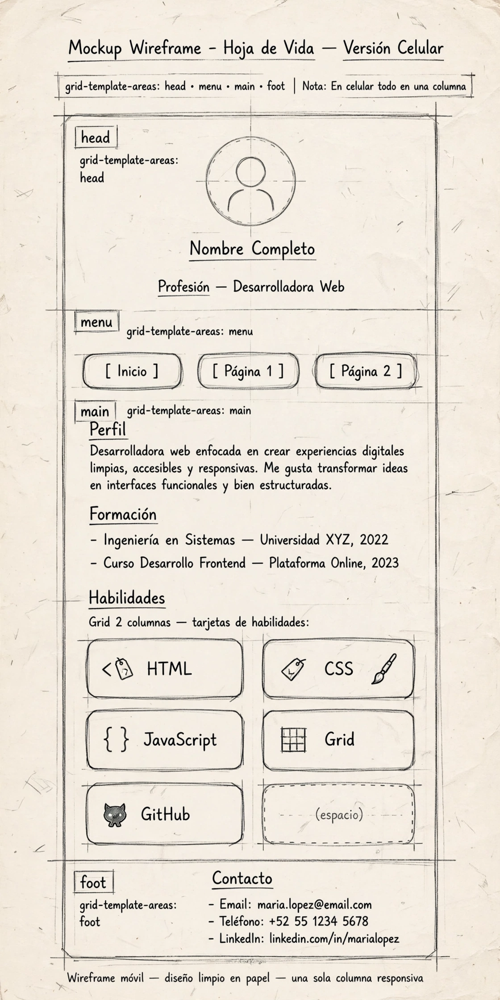
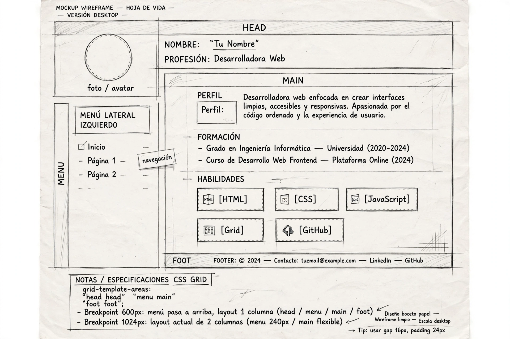
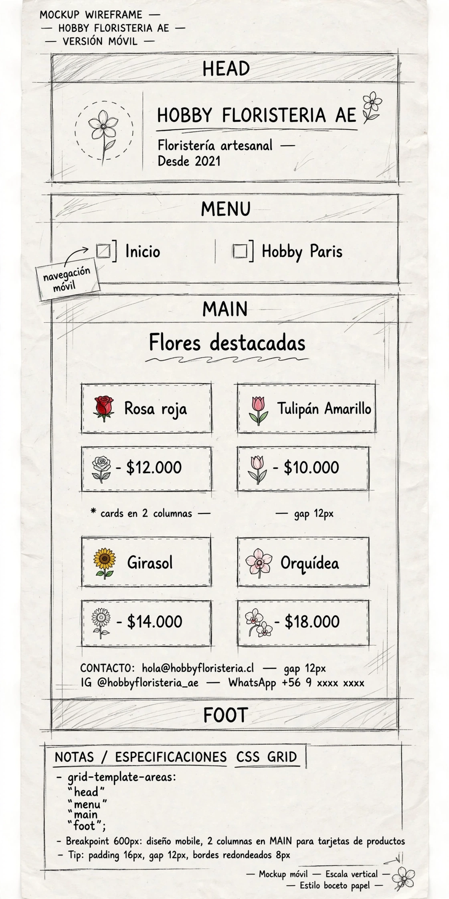
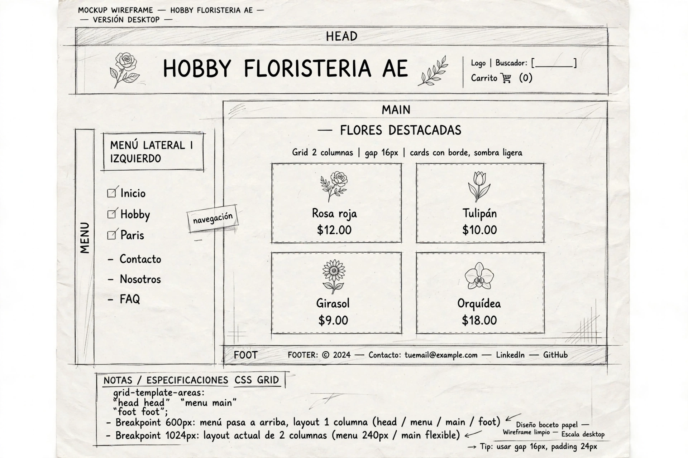
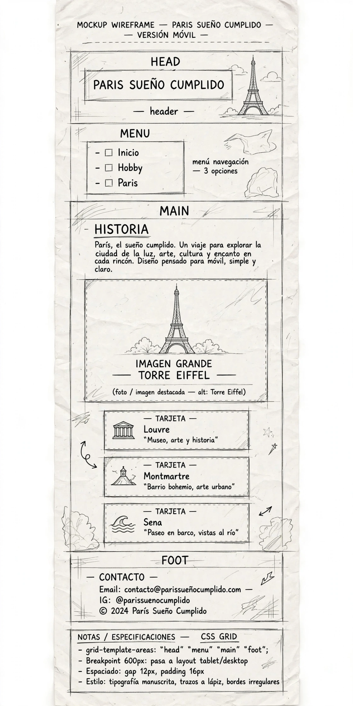
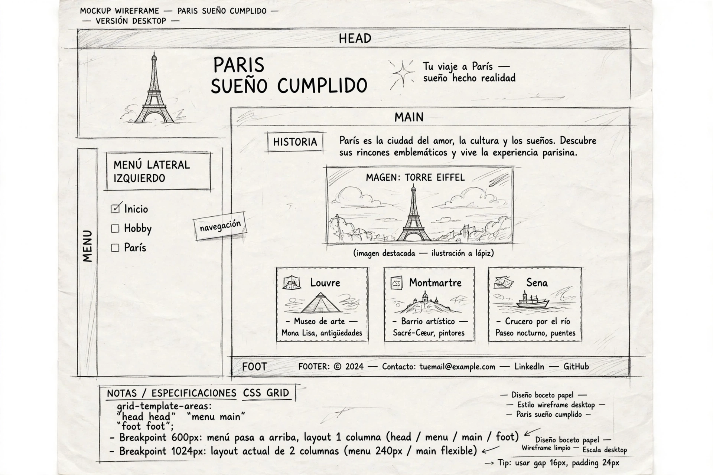

# Hoja de vida web · Yurly Zyrley Gonzalez Dulcey

Sitio personal con mi hoja de vida, mi hobby AE Floristería y mi sueño cumplido París. Desarrollado con HTML y CSS responsive Mobile First.

🔗 **Sitio publicado:** https://ingyurlygonzalezdulcey-creator.github.io/hoja-de-vida/

## Páginas
- index.html: hoja de vida (perfil, formación, experiencia, habilidades, idiomas)
- hobby.html: Mi hobby - AE Floristería y Eventos
- paris.html: Mi sueño cumplido - París

## Estructura del proyecto
- index.html, hobby.html, paris.html
- styles.css (Grid + Flexbox, Mobile First, R2-R4)
- img/foto.jpg, img/floristeria.jpg, img/paris.jpg (R7 con alt)
- mockups/ (R16)
- capturas/ (R17)

## Mockups
### Hoja de vida - index.html

### Hobby

### París

## Capturas del sitio publicado
R17 - 2 dispositivos, 1 real

## Breakpoints
R18
- **Base (0-599px) celular:** Una columna. `grid-template-areas: "cabecera" "menu" "principal" "pie"`. Mobile First.
- **600px:** Tarjetas de habilidades a 2 columnas con `repeat(auto-fit, minmax(160px, 1fr))`.
- **1024px:** Layout de 2 columnas: menú 14rem a la izquierda, contenido 1fr a la derecha. `grid-template-areas: "cabecera cabecera" "menu principal" "pie pie"`.

## Cómo lo publiqué
R19
1. Creé repo público `hoja-de-vida` en minúsculas.
2. Subí index.html, hobby.html, paris.html, styles.css, img/, mockups/, capturas/.
3. Settings > Pages > Source: Deploy from a branch > Branch: main / root > Save.
4. Esperé 3 min hasta que salió en verde "Your site is live".
5. Probé en incógnito y en celular que cargaran las 3 imágenes y los 3 links del menú.

## DeepWiki / Documentación del código
Este proyecto usa la Wiki de GitHub para explicar el CSS:
- **Layout:** `styles.css` usa CSS Grid para `.sitio` y Flexbox para `.menu` y `.tarjetas`
- **Responsive:** Mobile First + media queries 600px y 1024px
- **Accesibilidad:** Imágenes con alt descriptivo, contraste y nav consistente en las 3 páginas (R7-R9)
- **Validación:** HTML validado en validator.w3.org (R11)

## Fuentes consultadas
- docs.github.com - GitHub Pages
- MDN Web Docs - CSS Grid, grid-template-areas
- MDN Web Docs - repeat() y minmax()
- validator.w3.org - Validación HTML
- Figma - Mockups